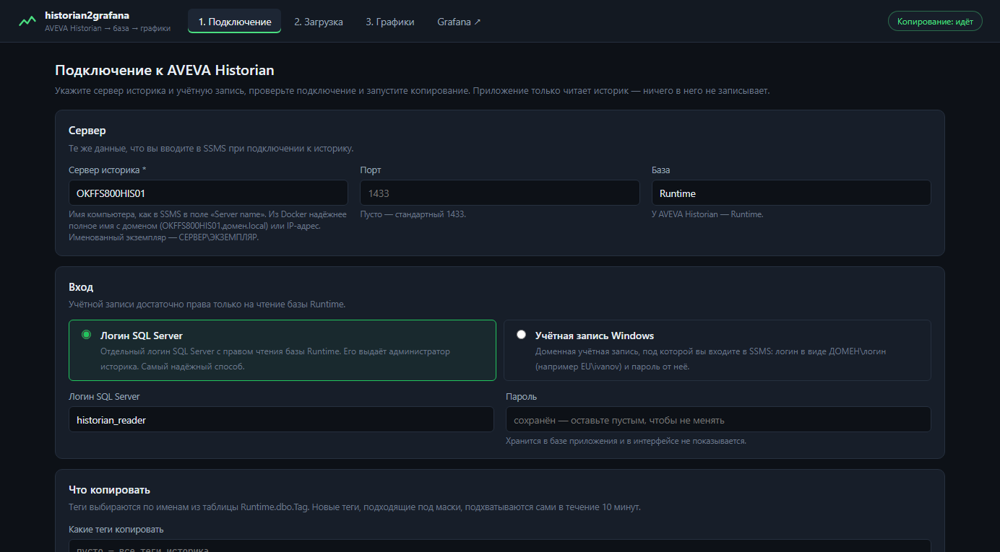
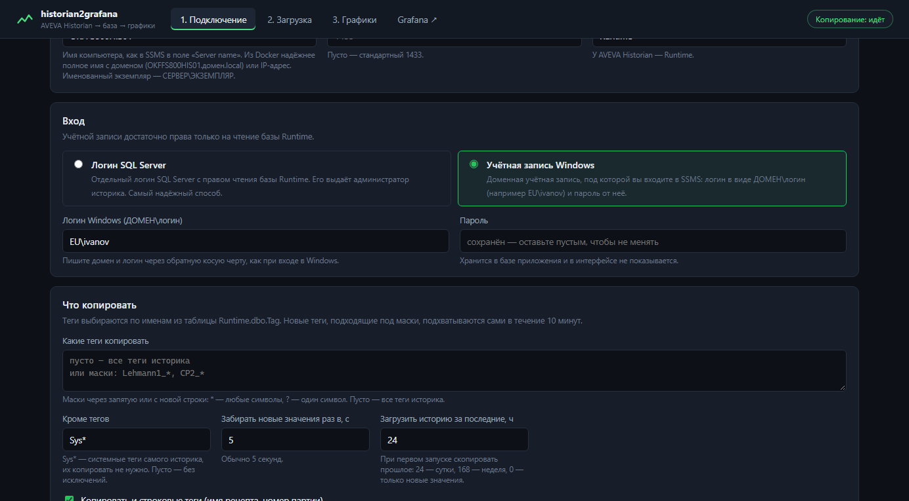
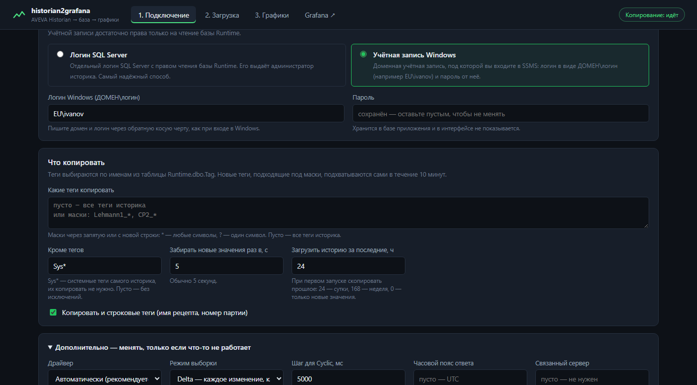
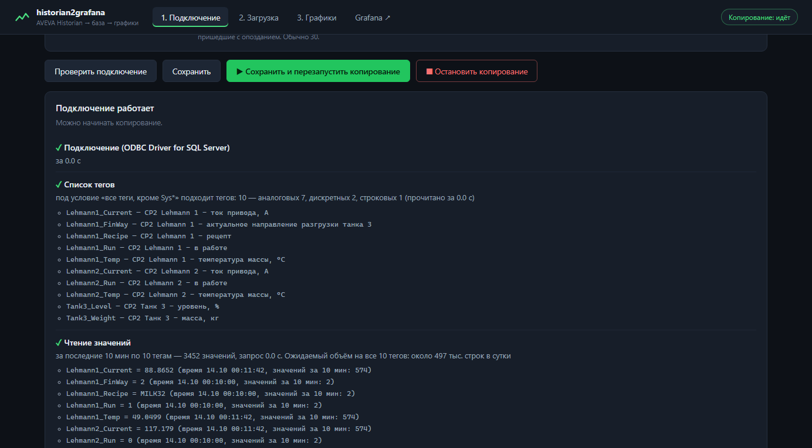
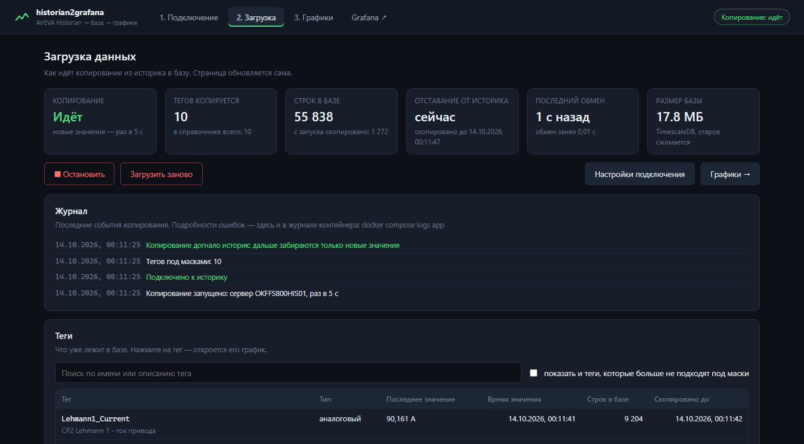
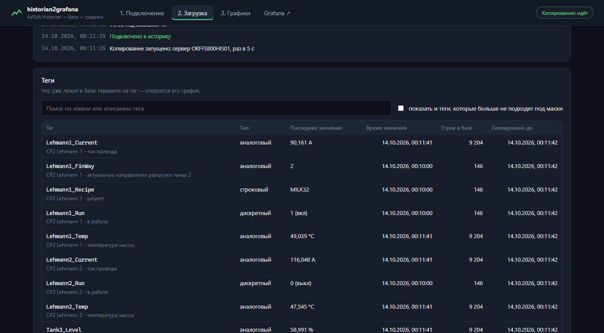
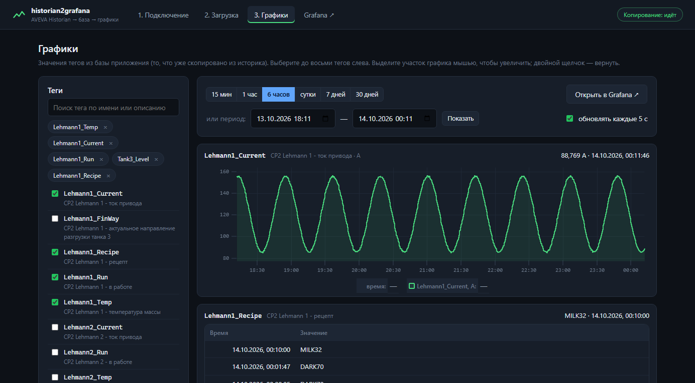
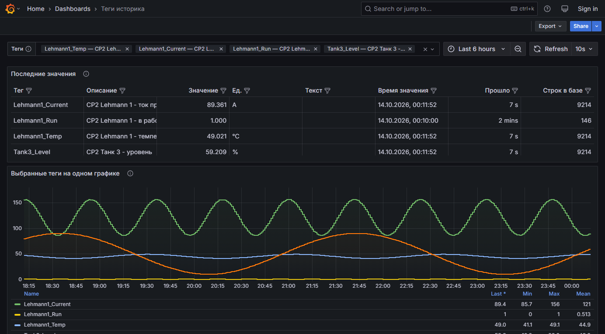
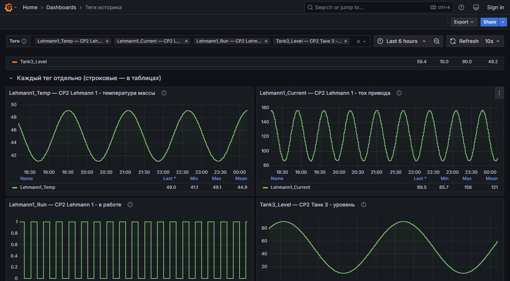
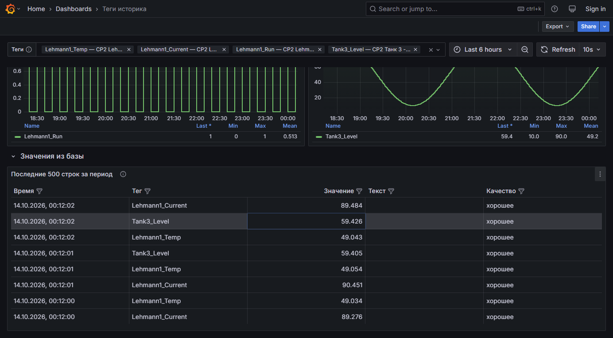

# historian2grafana — инструкция по развёртыванию в Docker Desktop и работе

Приложение копирует значения тегов из **AVEVA Historian** в собственную базу данных раз в несколько секунд и показывает по ней графики — на своей странице и в **Grafana**. Эта инструкция ведёт от чистого компьютера с Windows до графиков: установка Docker Desktop, запуск, подключение к историку, проверка, работа и решение проблем.

**Содержание**

- [1. Как это устроено](#1-как-это-устроено)
- [2. Что понадобится](#2-что-понадобится)
- [3. Установка Docker Desktop](#3-установка-docker-desktop)
- [4. Получение проекта](#4-получение-проекта)
- [5. Настройка и запуск](#5-настройка-и-запуск)
- [6. Проверка сети до историка](#6-проверка-сети-до-историка)
- [7. Подключение к историку](#7-подключение-к-историку)
- [8. Загрузка данных](#8-загрузка-данных)
- [9. Графики в приложении](#9-графики-в-приложении)
- [10. Графики в Grafana](#10-графики-в-grafana)
- [11. Повседневное управление](#11-повседневное-управление)
- [12. Сколько места занимают данные](#12-сколько-места-занимают-данные)
- [13. Установка без интернета](#13-установка-без-интернета)
- [14. Неполадки](#14-неполадки)
- [15. Частые вопросы](#15-частые-вопросы)
- [16. Что где лежит](#16-что-где-лежит)

## 1. Как это устроено

Всё приложение — три контейнера Docker, которые запускаются одной командой:

| Контейнер | Что делает | Где открыть |
|---|---|---|
| h2g-app — приложение | Подключается к историку, раз в 5 секунд забирает новые значения тегов и записывает в базу. Страницы «Подключение», «Загрузка», «Графики» | http://localhost:8000 |
| h2g-db — база данных | PostgreSQL 16 с расширением TimescaleDB для временных рядов. Хранит теги и их значения | снаружи не открывается |
| h2g-grafana — Grafana | Готовый дашборд «Теги историка» по данным базы | http://localhost:3000 |

Путь данных:

```text
AVEVA Historian (SQL Server, база Runtime)
        │  раз в 5 с: «что нового?» — только чтение
        ▼
h2g-app ──запись──► h2g-db (TimescaleDB) ──чтение──► графики в приложении и Grafana
```

- **Только чтение.** Приложение выполняет в историке только запросы SELECT: ничего не записывает и не меняет. Учётной записи достаточно права на чтение базы Runtime.
- **Первая загрузка.** При первом запуске копируется история за выбранный период (по умолчанию — сутки), дальше — только новые значения.
- **Без дублей и пропусков.** Для каждого тега запоминается, до какого момента он скопирован. После перерыва (нет сети, выключали компьютер) приложение докопирует пропущенное само.
- **Время** в базе хранится в UTC, на графиках показывается во времени вашего компьютера.

## 2. Что понадобится

| Что | Требование |
|---|---|
| Компьютер | Windows 10 (22H2) или Windows 11, 64-бит. Оперативной памяти — от 8 ГБ (лучше 16 ГБ), свободного места на диске — от 20 ГБ. В BIOS включена виртуализация (Intel VT-x или AMD-V) |
| Права | Администратор Windows — только для установки Docker Desktop |
| Сеть до историка | С этого компьютера открывается сервер историка по TCP-порту 1433 (или другому порту SQL Server). Проверка — в разделе 6 |
| Учётная запись историка | Одна из двух:<br>• логин SQL Server с правом чтения базы Runtime — самый надёжный вариант, его создаёт администратор историка;<br>• доменная учётная запись Windows, под которой вы входите в SSMS, — логин вида ДОМЕН\логин и пароль |
| Интернет | Нужен при первом запуске: скачиваются образы Docker (около 1,5 ГБ) и драйверы. Если на нужном компьютере интернета нет — см. раздел 13 |

> **Важно.** Docker Desktop бесплатен для личного использования, обучения и компаний до 250 сотрудников и с выручкой до 10 млн долларов в год. Крупной организации для рабочего использования нужна платная подписка — уточните в ИТ-службе.

## 3. Установка Docker Desktop

Если Docker Desktop уже установлен и работает — переходите к разделу 4.

1. Откройте страницу https://docs.docker.com/desktop/setup/install/windows-install/ и скачайте **Docker Desktop for Windows – x86_64**.
2. Запустите установщик **Docker Desktop Installer.exe**. На экране настроек оставьте отмеченным **Use WSL 2 instead of Hyper-V (recommended)** и нажмите **Ok**.
3. Когда установка закончится, нажмите **Close and restart** — компьютер перезагрузится.
4. Запустите **Docker Desktop** из меню «Пуск». Примите лицензионное соглашение (**Accept**). Вход в учётную запись Docker не обязателен — можно нажать **Skip**.
5. Дождитесь, пока внизу слева в окне Docker Desktop появится зелёная надпись **Engine running**.
6. Откройте PowerShell (меню «Пуск» → наберите «PowerShell») и проверьте:

```powershell
docker version
docker compose version
```

Обе команды должны напечатать номера версий без ошибок.

#### Если что-то пошло не так

| Сообщение | Что сделать |
|---|---|
| WSL 2 installation is incomplete / WSL needs updating | Откройте PowerShell от имени администратора, выполните `wsl --update` и перезагрузите компьютер |
| Virtualization support not detected | Включите виртуализацию в BIOS/UEFI (Intel VT-x, AMD-V или SVM Mode). Проверить: Диспетчер задач → Производительность → ЦП → «Виртуализация: Включено» |
| error during connect … dockerDesktopLinuxEngine | Docker Desktop не запущен или ещё запускается. Откройте его и дождитесь Engine running |
| Компьютер в сети с прокси-сервером | Docker Desktop → Settings → Resources → Proxies: включите Manual proxy configuration и укажите адрес прокси (спросите в ИТ-службе) |

Чтобы приложение запускалось само после включения компьютера: Docker Desktop → **Settings → General** → отметьте **Start Docker Desktop when you sign in to your computer**. Контейнеры приложения запустятся вместе с Docker Desktop.

## 4. Получение проекта

Положите проект в папку, в пути к которой нет русских букв и пробелов, например `C:\historian2grafana`.

- **С GitHub через git:** `git clone <адрес репозитория> C:\historian2grafana`
- **Архивом:** на странице репозитория **Code → Download ZIP**, распакуйте в `C:\historian2grafana` (внутри должны сразу лежать `docker-compose.yml`, `Dockerfile`, папки `app`, `web`, `grafana`).
- **С флешки или по сети:** просто скопируйте папку проекта целиком.

Все команды дальше выполняются в PowerShell **из папки проекта**. Чтобы открыть PowerShell сразу в ней: откройте папку в Проводнике, щёлкните в адресной строке, наберите `powershell` и нажмите Enter. Или перейдите в неё командой:

```powershell
cd C:\historian2grafana
```

## 5. Настройка и запуск

### 5.1 Файл .env — порты и пароли

Создайте файл настроек из образца и откройте его в Блокноте:

```powershell
Copy-Item .env.example .env
notepad .env
```

| Параметр | Что значит |
|---|---|
| APP_PORT | Порт приложения на этом компьютере, по умолчанию 8000 |
| GRAFANA_PORT | Порт Grafana, по умолчанию 3000 |
| DB_PASSWORD | Пароль базы данных приложения. Действует при **первом** запуске |
| GRAFANA_DB_PASSWORD | Пароль, под которым Grafana читает базу (у этой учётной записи — только чтение значений тегов) |
| GRAFANA_ADMIN_USER, GRAFANA_ADMIN_PASSWORD | Вход в Grafana для правки дашбордов. Действуют при первом запуске Grafana. Смотреть графики можно без входа |
| TZ | Часовой пояс журналов контейнера (Europe/Moscow). На графики не влияет |
| HISTORIAN_OLD_TLS | 1 — разрешить устаревшее шифрование для старых SQL Server. Включайте, только если проверка подключения пишет об ошибке SSL/TLS |
| GRAFANA_URL | Адрес Grafana для ссылок из приложения, если её открывают не по адресу этого компьютера. Обычно пусто |
| LOG_LEVEL | Подробность журналов: INFO или DEBUG |

Подключение к историку в этом файле **не задаётся** — его вводят в браузере (раздел 7). Без файла `.env` приложение тоже запустится — с паролями по умолчанию; для проверки этого достаточно, для постоянной работы поменяйте пароли.

### 5.2 Запуск

```powershell
docker compose up -d --build
```

Первый запуск занимает **5–15 минут**: Docker скачивает образы базы и Grafana, собирает образ приложения и ставит в него драйверы SQL Server. Следующие запуски — секунды.

Проверьте, что все три контейнера работают:

```powershell
docker compose ps
```

В столбце **STATUS** у `h2g-db` и `h2g-app` должно быть `Up … (healthy)`, у `h2g-grafana` — `Up`. То же видно в Docker Desktop на вкладке **Containers** — группа **historian2grafana**.

Откройте в браузере **http://localhost:8000** — появится страница «Подключение».

> **Совет.** Если страница не открывается, посмотрите журнал приложения: `docker compose logs --tail 50 app`. Частые причины — в разделе 14.

## 6. Проверка сети до историка

Прежде чем вводить настройки, убедитесь, что сервер историка вообще доступен с этого компьютера. В PowerShell (вместо OKFFS800HIS01 — имя вашего сервера):

```powershell
Test-NetConnection OKFFS800HIS01 -Port 1433
```

Нужна строка `TcpTestSucceeded : True`. Если там `False` — сервер недоступен по сети: проверьте имя и порт, спросите администраторов про брандмауэр. Приложение в этом случае тоже не подключится.

Затем проверьте то же **изнутри контейнера** — приложение работает в нём, и имена компьютеров оно ищет немного иначе, чем Windows:

```powershell
docker compose exec app python -m app.check OKFFS800HIS01 1433
```

Ответ `✓ адрес … ✓ открыт` — всё в порядке. Если Windows сервер находит, а контейнер пишет «не находится», — используйте **полное имя** сервера с доменом или его **IP-адрес**. Узнать их:

```powershell
Resolve-DnsName OKFFS800HIS01
```

В ответе: Name — полное имя (например `OKFFS800HIS01.eu.company.local`), IPAddress — адрес. Подставьте их в команду проверки из контейнера и потом в поле «Сервер историка».

#### Как узнать имя, адрес и порт через SSMS

Подключитесь к историку в SSMS как обычно и выполните запрос:

```sql
SELECT @@SERVERNAME AS server_name,
       CONNECTIONPROPERTY('net_transport') AS transport,
       CONNECTIONPROPERTY('local_net_address') AS ip_address,
       CONNECTIONPROPERTY('local_tcp_port') AS tcp_port;
```

Если `transport` не TCP, а `ip_address` пустой — SSMS подключён не по сети (например, прямо на сервере); тогда спросите адрес у администратора. Если SQL Server работает **именованным экземпляром** (в SSMS сервер записан как `СЕРВЕР\ЭКЗЕМПЛЯР`), его порт часто не 1433 — возьмите `tcp_port` из этого запроса.

## 7. Подключение к историку

Откройте **http://localhost:8000** → страница **1. Подключение**.



*Рис. 1. Страница «Подключение»*

### 7.1 Сервер

| Поле | Что вписать |
|---|---|
| Сервер историка | Имя компьютера, как в SSMS в поле Server name (например `OKFFS800HIS01`), а лучше — полное имя с доменом или IP-адрес (раздел 6). Именованный экземпляр — `СЕРВЕР\ЭКЗЕМПЛЯР` |
| Порт | Пусто — стандартный 1433. Другой — если SQL Server слушает другой порт |
| База | `Runtime` — база AVEVA Historian. Менять не нужно |

### 7.2 Вход

Выберите один из двух способов:

- **Логин SQL Server** — отдельный логин с правом чтения базы Runtime. Самый надёжный способ: не зависит от домена и политик Windows. Попросите администратора историка создать такой логин (роль db_datareader в базе Runtime).
- **Учётная запись Windows** — та, под которой вы входите в SSMS. Логин пишется вместе с доменом: `EU\ivanov`, пароль — пароль от этой учётной записи. Приложение войдёт по протоколу NTLM — так же, как SSMS с другого компьютера.



*Рис. 2. Вход учётной записью Windows: логин вместе с доменом*

> **Примечание.** Пароль хранится в базе приложения и в интерфейсе не показывается. Чтобы не менять сохранённый пароль, оставьте поле пустым. Если пароль учётной записи Windows сменился — введите новый и нажмите «Сохранить».

> **Важно.** Вход учётной записью Windows из Docker возможен, только если SQL Server принимает вход по NTLM (обычно да). Если проверка пишет «Login failed» при верном пароле или «соединение оборвалось при входе», попросите у администратора логин SQL Server.

### 7.3 Что копировать



*Рис. 3. Выбор тегов и дополнительные настройки*

| Поле | Что значит |
|---|---|
| Какие теги копировать | Маски имён тегов из таблицы Runtime.dbo.Tag через запятую или с новой строки. `*` — любые символы, `?` — один символ. Пример: `Lehmann1_*, CP2_*`. **Пусто — все теги историка** |
| Кроме тегов | Маски тегов, которые не нужны. По умолчанию `Sys*` — служебные теги самого историка |
| Забирать новые значения раз в, с | Как часто спрашивать историк о новых значениях. По умолчанию 5 секунд |
| Загрузить историю за последние, ч | Сколько прошлого скопировать при первом запуске: 24 — сутки, 168 — неделя, 0 — только новые значения |
| Копировать и строковые теги | Текстовые теги (имя рецепта, номер партии). Обычно оставьте включённым |

> **Совет.** Для первой проверки возьмите несколько знакомых тегов (например `Lehmann1_*`) и историю за 24 часа. Убедившись, что всё сходится с историком, расширьте маски — новые теги подхватятся сами.

Проверить маску заранее можно в SSMS (подчёркивание в LIKE берётся в квадратные скобки):

```sql
SELECT TagName, Description, TagType
FROM Runtime.dbo.Tag
WHERE TagName LIKE 'Lehmann1[_]%'
ORDER BY TagName;
```

### 7.4 Дополнительно

Раздел свёрнут — менять его нужно, только если что-то не работает:

| Поле | Когда менять |
|---|---|
| Драйвер | Автоматически: для логина SQL Server — Microsoft ODBC Driver 18, для учётной записи Windows — FreeTDS. Если подключение не выходит одним драйвером, попробуйте другой |
| Режим выборки | Delta — каждое изменение, как его записал историк (рекомендуется). Cyclic — одно значение на каждый шаг: меньше строк для очень часто меняющихся тегов |
| Шаг для Cyclic, мс | Только для режима Cyclic |
| Часовой пояс ответа | Пусто — историк сам отдаёт время в UTC. Если проверка пишет про wwTimeZone — укажите пояс сервера историка, например `Europe/Moscow` |
| Связанный сервер | Только если вы подключаетесь не к самому историку, а к другому SQL Server, где историк подключён связанным сервером (обычно `INSQL`) |
| Не брать последние, с | Самые свежие секунды историк может ещё дописывать. По умолчанию 3 |
| Перекрытие, с | Каждый раз немного перечитывать уже скопированное, чтобы подхватить опоздавшие значения. По умолчанию 30 |

### 7.5 Проверка и запуск копирования

Нажмите **Проверить подключение**. Приложение по шагам проверит:

1. **Подключение** — удалось ли войти; версии SQL Server и историка, часы сервера.
2. **Список тегов** — сколько тегов подходит под маски и первые из них.
3. **Чтение значений** — значения за последние 10 минут и оценка объёма: сколько строк в сутки будет копироваться.



*Рис. 4. Проверка прошла: подключение, теги и значения в порядке*

Если какой-то шаг не прошёл, под ним написано, что случилось и что делать (подробнее — раздел 14). Исправьте настройки и проверьте ещё раз.

Когда все три шага зелёные, нажмите **▶ Сохранить и начать копирование**. Приложение перейдёт на страницу «Загрузка». Настройки сохраняются в базе: после перезапуска компьютера или контейнеров копирование продолжится само.

Ту же проверку можно запустить из PowerShell — с сохранёнными настройками:

```powershell
docker compose exec app python -m app.check
```

## 8. Загрузка данных

Страница **2. Загрузка** показывает, как идёт копирование. Она обновляется сама каждые 3 секунды; состояние видно и в правом верхнем углу любой страницы.



*Рис. 5. Страница «Загрузка»: копирование идёт*

| Плитка | Что показывает |
|---|---|
| Копирование | **Идёт** — забираются новые значения; **Загрузка истории** — копируется прошлое, ниже — процент; **Подключение…**; **Ошибка** — причина в красной рамке, повтор автоматически; **Остановлено** |
| Тегов копируется | Сколько тегов подошло под маски |
| Строк в базе | Сколько значений уже лежит в базе |
| Отставание от историка | Насколько скопированное отстаёт от текущего времени. В обычной работе — «сейчас» или несколько секунд |
| Последний обмен | Когда приложение последний раз спрашивало историк и сколько длился обмен |
| Размер базы | Сколько места занимают данные. Данные старше 7 дней TimescaleDB сжимает в 10–20 раз |

**Журнал** — последние события: подключение, число тегов, ход загрузки истории, ошибки и восстановление связи. Полный журнал — командой `docker compose logs -f app` (выход — Ctrl+C).

**Теги** — что уже лежит в базе: последнее значение, его время, число строк и момент, до которого тег скопирован. Поиск — по имени и описанию. Щелчок по строке открывает график тега.



*Рис. 6. Таблица тегов на странице «Загрузка»*

#### Кнопки

- **■ Остановить / ▶ Запустить** — приостановить и продолжить копирование. После запуска приложение докопирует всё, что историк записал за время остановки.
- **Загрузить заново** — удалить все скопированные значения из базы приложения (в историке ничего не меняется) и загрузить историю заново. Нужно, например, если вы увеличили «Загрузить историю за последние»: уже скопированные теги сами в прошлое не догружаются.

> **Примечание.** Если поменять маски, теги, которые перестали под них подходить, больше не копируются, но их данные остаются в базе (флажок «показать и теги, которые больше не подходят под маски»).

## 9. Графики в приложении

Страница **3. Графики** строит графики прямо по базе приложения — без Grafana.



*Рис. 7. Страница «Графики»*

1. Слева найдите теги по имени или описанию и отметьте до восьми штук.
2. Выберите период кнопками (15 минут … 30 дней) или задайте начало и конец и нажмите **Показать**.
3. При включённом «обновлять каждые 5 с» график сам дорисовывает новые значения.
4. Выделите участок графика мышью — он увеличится; двойной щелчок — вернуть.

Числовые и дискретные теги рисуются ступенькой: значение держится до следующего изменения, как его записал историк. Строковые теги показываются таблицей изменений. Справа над каждым графиком — последнее значение и его время. Кнопка **Открыть в Grafana** открывает те же теги и период в Grafana.

## 10. Графики в Grafana

Откройте **http://localhost:3000** (или ссылку **Grafana ↗** в шапке приложения). Сразу откроется дашборд **«Теги историка»**. Входить не нужно — смотреть графики можно без пароля.



*Рис. 8. Дашборд «Теги историка» в Grafana*

1. Вверху в поле **Теги** выберите один или несколько тегов. Можно набирать часть имени или описания — список отфильтруется.
2. Справа вверху выберите период (**Last 6 hours** и др.) и частоту обновления (по умолчанию 10 с).
3. Выделите участок графика мышью, чтобы увеличить; кнопка с лупой — вернуть период назад.

| Панель | Что показывает |
|---|---|
| Последние значения | Последнее скопированное значение каждого выбранного тега, его время, сколько прошло и сколько строк тега в базе |
| Выбранные теги на одном графике | Все выбранные числовые и дискретные теги вместе; в легенде — последнее, минимум, максимум, среднее |
| Каждый тег отдельно | По графику на тег — удобно, когда у тегов разные единицы |
| Последние 500 строк за период | Значения так, как они лежат в базе: время, тег, значение, текст, качество. По ней удобно сверять копию с историком |



*Рис. 9. Отдельный график на каждый тег*



*Рис. 10. Строки из базы — для сверки с историком*

### 10.1 Сверка с историком

Чтобы убедиться, что копия совпадает с оригиналом, выполните в SSMS запрос по тому же тегу и сравните с панелью «Последние 500 строк за период»:

```sql
SELECT DateTime, TagName, Value, vValue, Quality
FROM Runtime.dbo.History
WHERE TagName = 'Lehmann1_FinWay'
  AND DateTime >= DATEADD(hour, -1, GETDATE())
  AND wwRetrievalMode = 'Delta'
ORDER BY DateTime DESC;
```

SSMS показывает время в часовом поясе сервера историка, Grafana и приложение — в поясе вашего компьютера. Обычно они совпадают. Самые свежие 3–8 секунд в базе могут ещё отсутствовать — они появятся при следующем обмене.

### 10.2 Свои панели

Чтобы менять дашборды, войдите в Grafana: **Sign in** справа вверху, логин и пароль — `GRAFANA_ADMIN_USER` / `GRAFANA_ADMIN_PASSWORD` из `.env` (по умолчанию admin / admin; Grafana предложит сменить пароль). Затем на дашборде **Edit → Add → Visualization**, источник данных **Historian DB**, режим запроса **Code** и, например:

```sql
SELECT $__timeGroupAlias(v.ts, $__interval), t.name AS metric, avg(v.value) AS value
FROM tag_value v
JOIN tag t ON t.tag_id = v.tag_id
WHERE t.name IN ('Lehmann1_Temp', 'Lehmann2_Temp')
  AND $__timeFilter(v.ts) AND v.quality = 0
GROUP BY 1, 2
ORDER BY 1
```

Таблицы базы для своих запросов:

| Таблица | Что в ней |
|---|---|
| tag | Справочник тегов: tag_id, name (имя в историке), description, unit, datatype (float64 — аналоговый, bool — дискретный, string — строковый), active |
| tag_value | Значения: ts (время, UTC), tag_id, value (число), value_text (текст), quality (0 — хорошее, 1 — плохое в историке) |
| tag_latest | Последнее значение каждого тега (представление) |
| tag_sync | До какого момента скопирован каждый тег и сколько у него строк |

> **Примечание.** Дашборд «Теги историка» поставляется файлом `grafana/dashboards/historian.json`. Изменения, сохранённые в Grafana, живут, пока этот файл не изменится (например, при обновлении приложения). Свои дашборды лучше сохранять отдельно: **Save as**.

## 11. Повседневное управление

Все команды — в PowerShell из папки проекта.

| Задача | Команда |
|---|---|
| Состояние контейнеров | `docker compose ps` |
| Журнал приложения (выход — Ctrl+C) | `docker compose logs -f app` |
| Остановить всё (данные сохраняются) | `docker compose stop` |
| Запустить снова | `docker compose start` |
| Перезапустить приложение | `docker compose restart app` |
| Применить изменения .env | `docker compose up -d` |
| Проверить подключение к историку | `docker compose exec app python -m app.check` |
| Проверить сеть до сервера | `docker compose exec app python -m app.check СЕРВЕР 1433` |
| Занятое место | `docker system df -v` |
| Удалить контейнеры, оставив данные | `docker compose down` |
| Удалить всё вместе с данными | `docker compose down -v` |

Контейнеры перезапускаются сами после сбоя и после перезагрузки компьютера (если Docker Desktop стартует при входе в Windows — раздел 3). Копирование продолжается с места остановки.

### 11.1 Доступ с других компьютеров

Приложение и Grafana открываются с любого компьютера сети по адресу этого ПК: `http://<IP этого компьютера>:8000` и `:3000`. Узнать IP — командой `ipconfig` (строка IPv4-адрес). Если с других компьютеров не открывается, разрешите порты в брандмауэре Windows (PowerShell от имени администратора):

```powershell
New-NetFirewallRule -DisplayName "historian2grafana" -Direction Inbound -Protocol TCP -LocalPort 8000,3000 -Action Allow
```

> **Важно.** Страница «Подключение» открыта всем, кто может зайти на порт 8000: там можно поменять настройки и остановить копирование. Открывайте порт 8000 только для своей сети.

### 11.2 Смена паролей

- **Grafana (admin):** в Grafana — значок профиля → **Change password**. Или командой: `docker compose exec grafana grafana cli admin reset-admin-password НовыйПароль`
- **GRAFANA_DB_PASSWORD:** поменяйте в `.env` и выполните `docker compose up -d` — приложение само обновит пароль в базе.
- **DB_PASSWORD** (после первого запуска): сначала в базе, потом в `.env`, затем `docker compose up -d`:

```powershell
docker compose exec db psql -U historian -d historian -c "ALTER USER historian PASSWORD 'НовыйПароль';"
```

### 11.3 Обновление приложения

Данные и настройки хранятся в томах Docker и при обновлении не теряются.

- Если проект получен через git: `git pull`, затем `docker compose up -d --build`.
- Если архивом: замените файлы проекта новыми (файл `.env` сохраните), затем `docker compose up -d --build`.

### 11.4 Резервные копии

Отдельные резервные копии не нужны: источник данных — историк, и всё можно скопировать заново кнопкой «Загрузить заново». Настройки подключения — это одна страница, их проще ввести снова.

## 12. Сколько места занимают данные

Проверка подключения оценивает, сколько строк в сутки будет копироваться. Одна строка занимает в базе около 80–100 байт; данные старше 7 дней сжимаются в 10–20 раз. Например, 1 млн строк в сутки — около 100 МБ в сутки первую неделю и 5–10 МБ в сутки после сжатия.

Если места мало: сузьте маски тегов, уменьшите глубину первой загрузки или включите режим Cyclic с крупным шагом для быстро меняющихся аналоговых тегов. Текущий размер — на странице «Загрузка» (плитка «Размер базы»).

## 13. Установка без интернета

Если на заводском компьютере нет доступа в интернет, соберите образы на любом компьютере с интернетом и Docker Desktop и перенесите их файлом.

На компьютере **с интернетом**, в папке проекта:

```powershell
docker compose build
docker compose pull db grafana
docker save -o historian2grafana-images.tar historian2grafana-app:latest timescale/timescaledb:latest-pg16 grafana/grafana:11.6.0
```

Перенесите на заводской компьютер папку проекта и файл `historian2grafana-images.tar` (около 1,5 ГБ). На нём, в папке проекта:

```powershell
docker load -i historian2grafana-images.tar
Copy-Item .env.example .env
docker compose up -d
```

Важно: здесь `docker compose up -d` **без** `--build` — образ приложения уже загружен, собирать его заново не нужно (и без интернета не получится).

## 14. Неполадки

### 14.1 Docker и запуск

| Что видно | Причина и что делать |
|---|---|
| `docker` не найдена или error during connect | Docker Desktop не установлен или не запущен. Запустите его и дождитесь Engine running |
| Сборка падает на apt-get, curl или pip: Could not resolve host, timeout | Нет интернета или нужен прокси. Настройте прокси в Docker Desktop (раздел 3) или перенесите образы (раздел 13) |
| port is already allocated / Bind for 0.0.0.0:8000 failed | Порт занят другой программой. Поменяйте APP_PORT или GRAFANA_PORT в `.env` и выполните `docker compose up -d` |
| http://localhost:8000 не открывается | `docker compose ps` — все ли контейнеры Up; `docker compose logs --tail 50 app` — что пишет приложение. Сразу после запуска подождите полминуты: база готовится |
| Контейнер h2g-app постоянно перезапускается | Смотрите `docker compose logs app`. Если пишет про пароль базы — DB_PASSWORD в `.env` поменяли после первого запуска (раздел 11.2) |

### 14.2 Подключение к историку

| Сообщение проверки | Причина и что делать |
|---|---|
| сервер не отвечает | Неверное имя или порт, сервер недоступен по сети, брандмауэр. Пройдите раздел 6; укажите полное имя с доменом или IP-адрес |
| Login failed for user … (18456) | Неверный логин или пароль, учётная запись заблокирована или у неё нет права читать базу Runtime. Для Windows логин пишется как ДОМЕН\логин |
| соединение оборвалось при входе (20002) | Чаще всего — неверный пароль или сервер не принимает такой способ входа (NTLM). Попробуйте другой драйвер (Дополнительно → Драйвер) или логин SQL Server |
| ошибка SSL / TLS / certificate | Старый SQL Server без современного шифрования. Поставьте `HISTORIAN_OLD_TLS=1` в `.env`, выполните `docker compose up -d` и проверьте снова; или выберите драйвер FreeTDS |
| wwTimeZone | Историк не принимает параметр часового пояса. Укажите пояс сервера в поле «Часовой пояс ответа» (например Europe/Moscow) |
| Invalid object name … History | Это не база историка: проверьте поле «База» (Runtime). Если вы подключены к другому SQL Server — заполните «Связанный сервер» |
| не подошёл ни один тег | Маски ничего не выбрали. Проверьте маску запросом в SSMS (раздел 7.3); помните, что `*` — любые символы |
| Значений нет (шаг «Чтение значений») | Не ошибка: выбранные теги за последние 10 минут не менялись. Копирование можно запускать |

### 14.3 Данные и графики

| Что видно | Причина и что делать |
|---|---|
| Долго «Загрузка истории» | Много тегов или большая глубина истории. Копирование продолжится само; ход виден в процентах. Можно сузить маски или уменьшить глубину и нажать «Загрузить заново» |
| Отставание растёт | Обмен длится дольше периода опроса: слишком много тегов или медленный историк. Увеличьте «Забирать новые значения раз в» или сузьте маски |
| Время на графиках сдвинуто на несколько часов | Историк отдаёт время не в UTC. Укажите пояс сервера в поле «Часовой пояс ответа», затем «Загрузить заново» |
| Grafana: No data | Не выбраны теги, в выбранном периоде нет данных или копирование не запущено — посмотрите страницу «Загрузка» |
| Grafana: password authentication failed for user grafana_reader | GRAFANA_DB_PASSWORD поменяли, а приложение не перезапустили: `docker compose up -d` |
| Тег есть в историке, но не в списке | Не подходит под маски или попал под «Кроме тегов». Новые теги подхватываются в течение 10 минут |

## 15. Частые вопросы

**Записывает ли приложение что-нибудь в историк?**  
Нет. Только запросы SELECT к базе Runtime: справочник тегов и история значений.

**Насколько свежие данные на графиках?**  
Раз в 5 секунд приложение забирает всё, что историк записал, кроме последних 3 секунд. Обычно значение появляется в базе через 5–10 секунд после записи в историк.

**Что будет, если историк или сеть недоступны?**  
На странице «Загрузка» появится ошибка, приложение будет повторять попытки (сначала через 5 секунд, потом реже — до 5 минут). Когда связь вернётся, оно докопирует всё пропущенное.

**А если выключить компьютер?**  
После включения (и запуска Docker Desktop) контейнеры стартуют сами, и копирование продолжится с того места, где остановилось. Пропущенное догрузится из историка.

**Нужно ли копировать все теги?**  
По умолчанию копируются все теги, кроме служебных Sys*. Для проверки удобнее начать с нескольких масок, затем расширить.

**Можно ли поменять глубину истории потом?**  
Да, но уже скопированные теги в прошлое сами не догружаются: после изменения нажмите «Загрузить заново» на странице «Загрузка».

**Где хранится пароль историка?**  
В базе приложения (том Docker на этом компьютере). Учётная запись, под которой Grafana читает базу, к настройкам доступа не имеет. Используйте учётную запись только для чтения.

**Совпадает ли копия с историком один в один?**  
В режиме Delta — да: каждое записанное историком значение со своим временем и качеством. Сверить можно по разделу 10.1.

## 16. Что где лежит

| Файл или папка | Что это |
|---|---|
| docker-compose.yml | Три контейнера и их настройки |
| .env.example → .env | Порты и пароли (раздел 5.1) |
| Dockerfile | Сборка образа приложения с драйверами SQL Server |
| app/ | Приложение на Python: подключение к историку (historian.py), копирование (sync.py), база (db.py, schema.sql), страницы и API (main.py), проверка (check.py) |
| web/ | Страницы в браузере |
| grafana/ | Источник данных и дашборд Grafana |
| docker/ | Настройки драйвера FreeTDS и OpenSSL |
| tests/ | Автоматические тесты |
| docs/ | Эта инструкция |

Данные живут в томах Docker: `historian2grafana_db-data` (база) и `historian2grafana_grafana-data` (Grafana). Их видно в Docker Desktop на вкладке **Volumes**.
